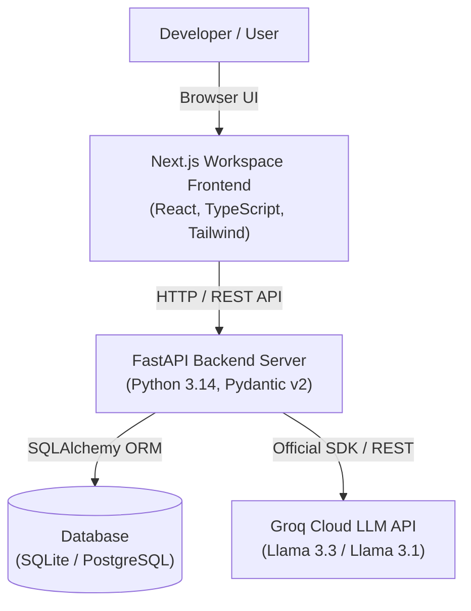

# DevPilot System Architecture — Foundation

**Document:** `docs/architecture/overview.md`  
**Status:** Approved for Chapter 1  
**Scope:** Foundation and Project Setup  

---

## 1. High-Level Architecture

DevPilot follows a decoupled client-server architecture designed to support a multi-agent orchestration engine in later chapters:



---

## 2. Component Breakdown

### 2.1 Frontend (Presentation Layer)
- **Framework:** Next.js with TypeScript and App Router.
- **Styling:** Tailwind CSS with a dark-themed engineering workspace aesthetic.
- **Role in Chapter 1:** Provides an operational dashboard showing live backend connectivity, system status, and environment health checks.
- **API Client:** Dedicated, typed `api.ts` module with robust error handling and loading states.

### 2.2 Backend (Application & API Layer)
- **Framework:** FastAPI running on Uvicorn.
- **Configuration:** `pydantic-settings` loading and validating environment variables cleanly.
- **Routing:** Versioned modular routing under `/api/v1/`.
- **Health Checks:** `/health` (liveness) and `/api/v1/health` (detailed component health: backend, database, LLM config).
- **Error Handling:** Centralized exception handlers ensuring internal server traces are never leaked in client-facing HTTP responses.

### 2.3 Data Layer
- **ORM:** SQLAlchemy 2.0 with declarative mapping.
- **Database Engine:** SQLite default for zero-friction local development, PostgreSQL compatible via `DATABASE_URL`.
- **Migrations:** Alembic configuration structure prepared for schema evolution.

### 2.4 External Integration (Groq LLM)
- **Module:** `backend/app/integrations/groq_client.py`.
- **Design:** Provider isolation pattern. Future chapters can expand or adapt models without altering business logic.
- **Security:** API keys are injected via environment variables; never logged or exposed to the frontend.

---

## 3. Communication Contracts (Chapter 1)

### `GET /api/v1/health`
Response:
```json
{
  "status": "healthy",
  "version": "0.1.0",
  "environment": "development",
  "timestamp": "2026-11-14T06:00:00Z",
  "components": {
    "database": {
      "status": "connected",
      "engine": "sqlite"
    },
    "llm": {
      "provider": "groq",
      "configured": true,
      "model": "llama-3.3-70b-versatile"
    }
  }
}
```

